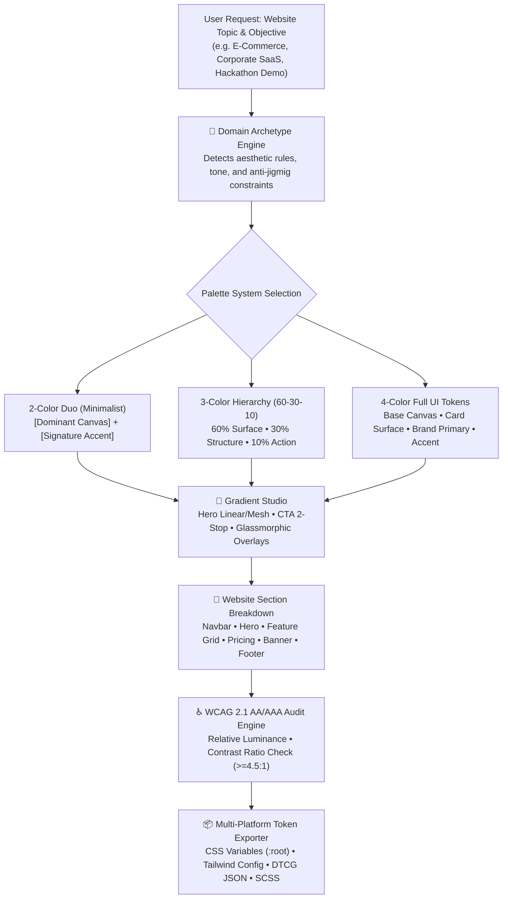

# chroma-craft 🎨

> **Production-Ready, Cross-Platform AI Agent Skill for Web Palettes, CSS Gradients, and Design System Color Architecture.**

[](LICENSE)
[](https://agentskills.io)
[](#authorship)
[](#)
[](#accessibility)

---

## Overview

**Chroma-Craft** (also known as `web-palette-engine`) is an open, cross-platform agent skill that teaches AI coding assistants (**Google Antigravity**, **Claude Code**, and **OpenAI Codex**) how to recommend, construct, and implement harmonious, accessible, context-aware color schemes, design tokens, and CSS linear gradients for websites and web applications.

### The Problem It Solves:
When AI coding agents build websites, they frequently fall into recurring aesthetic pathologies:
1. **The "Jigmig" Anti-Pattern:** Adding gaudy, distracting multi-color mesh gradients and flashing holographic borders to serious enterprise or e-commerce websites.
2. **Contrast Blindness:** Generating unreadable white buttons with light cyan or lime labels ($<1.5:1$ contrast ratio), severely violating WCAG 2.1 accessibility.
3. **Muddy Dark Mode:** Naively setting dark backgrounds to `#000000` (causing OLED smearing and eyestrain) or using low-contrast dark cards that dissolve into murky grey soup.
4. **Context Amnesia:** Using the same generic template for an e-commerce storefront, an enterprise B2B SaaS dashboard, and a hackathon project.

Chroma-Craft eliminates these flaws by establishing a rigorous mathematical color foundation, topic-specific design archetypes, and section-by-section layout rules.

---

## Core System Architecture



---

## 1. The Canonical 46-Color Library

Chroma-Craft operates on a strictly controlled roster of **41 base colors** plus **5 curated complementary accents**:

### A. The Mandatory Base Roster (41 Colors)

| Family | Count | Canonical Colors & Exact Hex Codes |
| :--- | :---: | :--- |
| **Neutrals & Whites** | 6 | `Snow White` (`#FBFBFD`), `Ivory White` (`#FFFFF0`), `Pearl White` (`#F8F6F0`), `Grey` (`#6B7280`), `Silver` (`#C0C0C8`), `Beige` (`#E8DCC4`) |
| **Blues (STRICT)** | 7 | `Ice Blue` (`#DDF2FD`), `Baby Blue` (`#89CFF0`), `Ocean Blue` (`#0077BE`), `Midnight Blue` (`#191970`), `Electric Blue` (`#0066FF`), `Arctic Blue` (`#C6E2FF`), `Steel Blue` (`#4682B4`) |
| **Greens & Cyans** | 6 | `Cyan` (`#00E5FF`), `Teal` (`#008080`), `Lime` (`#00FF00`), `Lime Green` (`#32CD32`), `Forest Green` (`#228B22`), `Moss Green` (`#8A9A5B`) |
| **Reds** | 4 | `Crimson Red` (`#DC143C`), `Scarlet Red` (`#FF2400`), `Apple Red` (`#8E1A1A`), `Rose Red` (`#C21E56`) |
| **Pinks** | 5 | `Pink` (`#FFC0CB`), `Baby Pink` (`#F4C2C2`), `Dusty Pink` (`#DCAE96`), `Hot Pink` (`#FF69B4`), `Magenta` (`#FF00FF`) |
| **Purples & Violets** | 8 | `Purple` (`#800080`), `Deep Purple` (`#36013F`), `Royal Purple` (`#7851A9`), `Plum Purple` (`#5A1846`), `Lavender Purple` (`#967BB6`), `Violet` (`#8F00FF`), `Violet Purple` (`#6A0DAD`), `Indigo` (`#4B0082`) |
| **Browns & Earth Tones** | 5 | `Brown` (`#8B4513`), `Chocolate Brown` (`#3D1C02`), `Coffee Brown` (`#4A2C2A`), `Caramel Brown` (`#AF6E4D`), `Gold` (`#D4AF37`) |

> [!IMPORTANT]
> **Strict Blue List Rule:** The Blue family is strictly confined to the **7 blues** listed above. No unauthorized blues may be invented.

### B. Curated Complementary Accents (5 Modern UI Shades)
- `Terracotta` (`#E07A5F`) — Warm editorial accent, tactile organic touch.
- `Sage Green` (`#9CAF88`) — Calming organic neutral, sustainable brand token.
- `Amber Gold` (`#F59E0B`) — Vibrant high-conversion action button, star ratings.
- `Charcoal Onyx` (`#121214`) — Modern dark-mode surface, ultra-crisp 18.1:1 light body text.
- `Blush Peach` (`#FEE2E2`) — Soft background wash, subtle card hover aura.

---

## 2. Topic Archetypes & The "Anti-Jigmig" Law

Chroma-Craft enforces contextual aesthetic discipline:

| Domain | Aesthetic Tone | Background Canvas | Conversion Action (CTA) | Strict "Anti-Jigmig" Prohibitions |
| :--- | :--- | :--- | :--- | :--- |
| **E-Commerce Storefront** | Product-first, clear, high conversion | `Snow White` (`#FBFBFD`) | `Amber Gold` (`#F59E0B`) or `Forest Green` (`#228B22`) | ❌ No rainbow mesh gradients behind product photos. Product photography must remain the visual center. |
| **Corporate B2B SaaS** | Authoritative, sober, institutional | `Snow White` (`#FBFBFD`) / `Pearl White` | `Ocean Blue` (`#0077BE`) or `Steel Blue` | ❌ No flashy neon glows, particle animations, or game-like borders. High contrast ($>7:1$) on text. |
| **Hackathon & AI Launch** | Electric, punchy, futuristic | `Charcoal Onyx` (`#121214`) | `Electric Blue to Cyan Gradient` | ❌ No boring low-contrast grey templates. Bold glowing accents and sharp contrast for judges. |
| **Personal Portfolio** | Distinctive, editorial, minimalist | `Ivory White` or `Charcoal Onyx` | `Terracotta` (`#E07A5F`) or `Electric Blue` | ❌ No generic bootstrap multi-color clutter. Employs the Signature Duo. |
| **Fintech & Banking** | Fiscal stability, confidence | `Snow White` (`#FBFBFD`) | `Midnight Blue` / `Forest Green` (+) | ❌ Ambiguous metric colors. Green strictly for gains, Red strictly for risk. |
| **Luxury & Hospitality** | Artisanal, warm, opulent | `Ivory White` (`#FFFFF0`) / `Beige` | `Gold` (`#D4AF37`) / `Caramel Brown` | ❌ Absolutely zero cold cyans, neon blues, or fluorescent greys. |

---

## 3. Website Section-by-Section Color Assignment

Every web page is partitioned into purposeful zones:

1. **Navigation Bar (Header):**
   - Light: `rgba(251, 251, 253, 0.85)` surface + `backdrop-filter: blur(12px)` + `1px solid rgba(192, 192, 200, 0.4)` border. Logo in `#121214`.
   - Dark: `rgba(18, 18, 20, 0.85)` surface + `backdrop-filter: blur(12px)` + `1px solid rgba(255, 255, 255, 0.08)` border. Logo in `#FBFBFD`.
2. **Hero Section (First Fold):**
   - H1 Headline: Crisp `#121214` (Light) or `#FBFBFD` (Dark) with $>18:1$ contrast.
   - Subheadline: `#6B7280` (`Grey`, Light) or `#C0C0C8` (`Silver`, Dark).
   - Primary CTA: High-impact 2-stop linear gradient (`Electric Blue to Cyan` or `Amber Gold to Terracotta`).
   - Secondary CTA: Ghost button with `1px solid #C0C0C8` and transparent background.
3. **Feature Grid / Cards:**
   - Container Background: `#F8F6F0` Pearl White to subtly distinguish from the pure white hero.
   - Individual Cards: `#FBFBFD` Snow White with `1px solid #C0C0C8` border.
   - Icon Box: 12% opacity tint of primary brand color with solid brand icon.
4. **Pricing / Product Showcase:**
   - Featured Tier Card: Elevated with `2px solid` Brand Primary border and `Amber Gold` badge.
   - Price Number: Maximum contrast font color.
   - Feature Checkmarks: `#228B22` Forest Green (included) vs `#C0C0C8` Silver (excluded).
5. **CTA / Conversion Banner:**
   - Container: Full-bleed `linear-gradient(135deg, #191970 0%, #0077BE 100%)`.
   - Text: Pure `#FBFBFD` Snow White.
   - Action Button: `#F59E0B` Amber Gold or `#FBFBFD` solid white button with navy text.
6. **Footer:**
   - Surface: Deep anchor `#121214` Charcoal Onyx or minimal `#F8F6F0` Pearl White.
   - Links: `#6B7280` Grey transitioning to Brand Primary on hover.

---

## 4. CSS Gradient Studio Formulas

### Linear Background Gradients
```css
/* Corporate Clean Wash */
background: linear-gradient(180deg, #FBFBFD 0%, #F8F6F0 100%);

/* Enterprise Sky Tint */
background: linear-gradient(180deg, #FBFBFD 0%, #C6E2FF 100%);

/* Cyber Nebula (Hackathon Dark Canvas) */
background: linear-gradient(135deg, #121214 0%, #191970 50%, #0066FF 100%);

/* Champagne Silk (Luxury) */
background: linear-gradient(135deg, #FFFFF0 0%, #E8DCC4 50%, #F8F6F0 100%);
```

### High-Conversion CTA Buttons
```css
/* SaaS / Hackathon Action Primary */
background: linear-gradient(135deg, #0066FF 0%, #00E5FF 100%); /* text: #121214 */

/* E-Commerce Add to Cart */
background: linear-gradient(135deg, #F59E0B 0%, #E07A5F 100%); /* text: #121214 */

/* Luxury Tier Upgrade */
background: linear-gradient(135deg, #D4AF37 0%, #AF6E4D 100%); /* text: #3D1C02 */
```

### Glassmorphic Overlays
```css
/* Light Floating Navigation / Card Header */
background: linear-gradient(135deg, rgba(251, 251, 253, 0.85) 0%, rgba(248, 246, 240, 0.65) 100%);
backdrop-filter: blur(12px);
border: 1px solid rgba(192, 192, 200, 0.4);

/* Dark Modal Surface */
background: linear-gradient(135deg, rgba(18, 18, 20, 0.80) 0%, rgba(25, 25, 112, 0.25) 100%);
backdrop-filter: blur(16px);
border: 1px solid rgba(255, 255, 255, 0.08);
```

---

## 5. Built-in Python Tooling

Chroma-Craft includes pure Python stdlib scripts in `skill/scripts/` (zero dependencies, instant execution):

```bash
# 1. Color Roster Query
python chroma-craft/skill/scripts/palette-generator.py list-colors

# 2. Domain Token Generation (CSS, Tailwind, JSON)
python chroma-craft/skill/scripts/palette-generator.py domain ecommerce --format css
python chroma-craft/skill/scripts/palette-generator.py domain corporate --format tailwind
python chroma-craft/skill/scripts/palette-generator.py domain hackathon --format json

# 3. Section Blueprint Inspection
python chroma-craft/skill/scripts/palette-generator.py section hero
python chroma-craft/skill/scripts/palette-generator.py section pricing

# 4. WCAG 2.1 Color Contrast Checker
python chroma-craft/skill/scripts/wcag-checker.py "#121214" "#FBFBFD"

# 5. Multi-Platform Design Token Exporter
python chroma-craft/skill/scripts/token-exporter.py corporate --format dtcg -o tokens.json
python chroma-craft/skill/scripts/token-exporter.py ecommerce --format scss -o _tokens.scss

# 6. Comprehensive Verification Test Suite
python chroma-craft/skill/scripts/test-chroma-craft.py
```

---

## Directory Structure

```text
chroma-craft/
├── README.md                          # Primary overview and usage documentation
├── LICENSE                            # MIT License
├── NOTICE                             # Attribution and trademark disclaimer
├── AUTHORS                            # Author and contributor roster
├── .gitignore                         # Repository ignore rules
├── docs/                              # Deep technical specifications
│   ├── architecture.md                # 3-tier token hierarchy & color theory
│   ├── color-matrix.md                # Complete 46-color matrix with RGB, HSL & luminance
│   ├── domain-guidelines.md           # In-depth domain guidelines & anti-jigmig rules
│   ├── portability.md                 # Antigravity, Claude Code, Codex & Cursor setup
│   └── contributing.md                # Contribution guidelines
├── skill/                             # The core Agent Skill package
│   ├── SKILL.md                       # Canonical Agentskills.io manifest & prompt instructions
│   ├── references/                    # Detailed reference documentation
│   │   ├── color-roster.md            # The 41+5 color library and strict blue constraints
│   │   ├── domain-archetypes.md       # E-commerce, Corporate, Hackathon, Portfolio guidelines
│   │   ├── website-sections.md        # Navbar, Hero, Cards, Pricing, Banner, Footer breakdown
│   │   ├── palette-recipes.md         # 2-color, 3-color (60-30-10), and 4-color tokens
│   │   ├── gradient-studio.md         # Ready-to-copy CSS linear and mesh gradient formulas
│   │   └── accessibility-matrix.md    # WCAG 2.1 relative luminance & contrast matrices
│   └── scripts/                       # Pure Python CLI automation tools
│       ├── palette-generator.py       # Domain token generator & section blueprint engine
│       ├── wcag-checker.py            # WCAG 2.1 relative luminance and contrast auditor
│       ├── token-exporter.py          # Exporter for DTCG JSON, SCSS, Swift, Android
│       └── test-chroma-craft.py       # Automated test suite (100% pass)
├── examples/                          # Ready-to-inspect reference implementations
│   ├── 01-ecommerce-store/            # Pristine white storefront tokens & amber CTA
│   ├── 02-corporate-enterprise/       # Sober enterprise B2B SaaS tokens
│   ├── 03-hackathon-showcase/         # Radiant dark-mode cyber nebula tokens
│   └── 04-personal-portfolio/         # Editorial terracotta duo portfolio tokens
└── integrations/                      # Multi-platform agent configurations
    ├── antigravity/                   # Google Antigravity plugin manifest & guide
    ├── claude-code/                   # Anthropic Claude Code configuration
    ├── codex/                         # OpenAI Codex & ChatGPT instructions
    ├── cursor/                        # Cursor IDE .mdc rules
    └── generic/                       # Universal LangChain/AutoGen adapter
```

---

## Authorship

Chroma-Craft was conceived, architected, and engineered by **SWAYAM KIRAN PRABHU**.

Licensed under the [MIT License](LICENSE).
