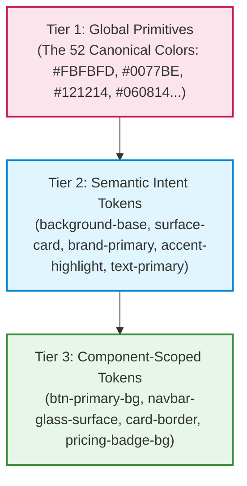

# Chroma-Craft Architecture & Design Token System

> **Architectural foundation, mathematical color theory, and token hierarchy for Chroma-Craft.**

---

## 1. Design Token Hierarchy

Chroma-Craft enforces a strict three-tier token hierarchy compliant with the W3C Design Tokens Community Group (DTCG) specification:

### Tier 1: Global Primitives
Raw color values defined by their canonical human-readable names and hex codes (e.g., `Ocean Blue` = `#0077BE`). Primitives are immutable and must not be used directly in component styling.

### Tier 2: Semantic Intent Tokens
Tokens that carry UX meaning rather than color names:
- `--color-background-base`
- `--color-surface-card`
- `--color-brand-primary`
- `--color-accent-highlight`
- `--color-text-primary`
- `--color-border-subtle`

These tokens change values dynamically when switching between Light Mode and Dark Mode.

### Tier 3: Component Tokens
Tokens assigned to specific UI elements:
- `--navbar-bg: var(--color-background-base);`
- `--card-bg: var(--color-surface-card);`
- `--btn-primary-bg: var(--gradient-cta);`

---

## 2. Mathematical Color Theory & Contrast

### Relative Luminance ($L$)
Relative luminance is the relative brightness of any point in a colorspace, normalized to 0 for darkest black and 1 for lightest white.

Chroma-Craft implements the exact WCAG 2.1 formula:

$$L = 0.2126 \cdot R_{\text{linear}} + 0.7152 \cdot G_{\text{linear}} + 0.0722 \cdot B_{\text{linear}}$$

Where the conversion from sRGB (8-bit value 0..255) to linear gamma is:

$$C_{\text{sRGB}} = \frac{C}{255}$$

$$C_{\text{linear}} = \begin{cases} \frac{C_{\text{sRGB}}}{12.92} & \text{if } C_{\text{sRGB}} \le 0.04045 \\ \left(\frac{C_{\text{sRGB}} + 0.055}{1.055}\right)^{2.4} & \text{if } C_{\text{sRGB}} > 0.04045 \end{cases}$$

### Contrast Ratio ($CR$)
Given two colors with relative luminances $L_1$ and $L_2$ ($L_1 > L_2$):

$$CR = \frac{L_1 + 0.05}{L_2 + 0.05}$$

- Minimum ratio: $1.0 : 1$ (identical colors)
- Maximum ratio: $21.0 : 1$ (pure white on pure black)

---

## 3. Spatial Color Weighting (The 60-30-10 Rule)

In effective web interfaces, colors are not distributed equally:
1. **60% Surface Canvas:** The background and base atmosphere. Guarantees long reading sessions without ocular fatigue.
2. **30% Structural Frame:** Card containers, headers, sidebars, borders, muted body text. Establishes layout structure.
3. **10% Action Accent:** High-contrast buttons, active navigation markers, status indicators. Guides the user's eye to high-value actions.
