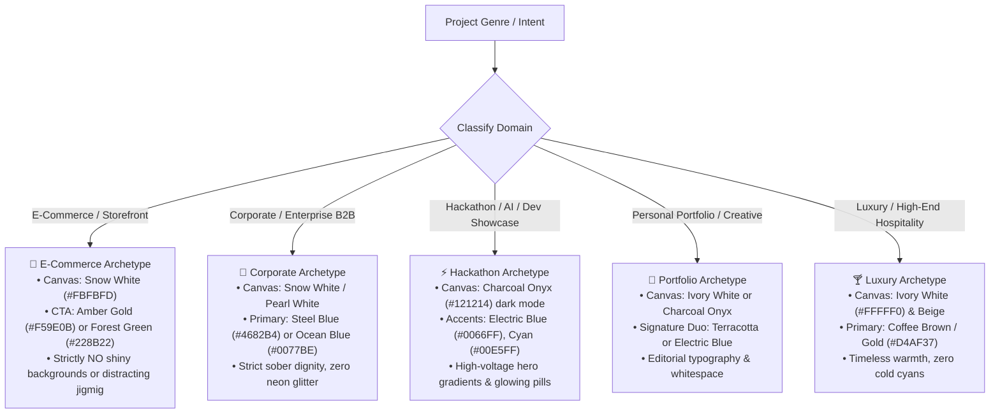

# Chroma-Craft: Web Palette Engine & Design System Advisor

Chroma-Craft is a production-ready, cross-platform AI Agent Skill designed to empower AI coding assistants across **Google Antigravity**, **Claude Code**, and **OpenAI Codex** to recommend, construct, and implement harmonious, accessible color palettes and CSS gradients for web applications and frontends.

> **Central Mission:** Stop AI coding assistants from generating chaotic, unreadable, or aesthetically inappropriate website colors ("jigmig", flashy neon buttons on white backgrounds, or unreadable low-contrast cards). Chroma-Craft enforces context-aware color theory, strict WCAG 2.1 AA accessibility, and disciplined design tokens mapped directly to the website's genre.

---

## 1. When to Use This Skill

Activate this skill whenever:
* You are building, styling, or scaffolding a new website, landing page, dashboard, or web frontend.
* You need to select a brand color scheme or theme (Light Mode, Dark Mode, or dual-mode switching).
* You are creating CSS variables (`:root { ... }`), Tailwind CSS theme configurations (`tailwind.config.js`), or design token JSONs.
* You are styling specific website sections (Hero, Sticky Navbar, Feature Grid Cards, Pricing Tables, CTA Banners, Footer).
* You need CSS gradients for page backgrounds, hero banners, high-conversion buttons, or glassmorphic overlays.
* You want to audit an existing frontend for WCAG 2.1 AA/AAA color contrast and readability.

Do NOT use this skill to:
* Arbitrarily introduce random colors outside the curated roster without justification.
* Apply bright fluorescent buttons or animated multi-color gradients to serious corporate or e-commerce storefronts.
* Violate WCAG 2.1 AA contrast rules ($<4.5:1$ for body text, $<3:1$ for large text).
* Force pitch-black (`#000000`) surfaces in dark mode instead of calibrated dark neutrals (`#121214 Charcoal Onyx`).

---

## 2. The 52-Color Canonical Library

Chroma-Craft operates on a mathematically calibrated roster of 52 exact hex shades:

### A. The Mandatory Base Roster (41 Colors)
1. **Neutrals & Whites (6):**
   - `Snow White` (`#FBFBFD`) — Clean, cool primary light canvas.
   - `Ivory White` (`#FFFFF0`) — Warm editorial reading canvas.
   - `Pearl White` (`#F8F6F0`) — Secondary card and section container.
   - `Grey` (`#6B7280`) — Subdued secondary text, inactive icons.
   - `Silver` (`#C0C0C8`) — Crisp 1px UI borders, card dividers.
   - `Beige` (`#E8DCC4`) — Warm artisanal sand, luxury card backplate.
2. **Blues (STRICT LIST — EXACTLY 7 BLUES — DO NOT ADD ANY OTHER BLUES):**
   - `Ice Blue` (`#DDF2FD`) — Surface tint, soft informational badge.
   - `Baby Blue` (`#89CFF0`) — Gentle feature tag, soft pill.
   - `Ocean Blue` (`#0077BE`) — Authoritative corporate primary, high-trust CTA.
   - `Midnight Blue` (`#191970`) — Deep enterprise anchor, dark canvas.
   - `Electric Blue` (`#0066FF`) — High-energy SaaS primary, interactive focus ring.
   - `Arctic Blue` (`#C6E2FF`) — Ambient cool gradient stop, dark mode text.
   - `Steel Blue` (`#4682B4`) — Industrial brand primary, stable navigation link.
3. **Greens & Cyans (6):**
   - `Cyan` (`#00E5FF`) — Cyberpunk accent, dark-mode button stop.
   - `Teal` (`#008080`) — Balanced healthcare & fintech brand primary.
   - `Lime` (`#00FF00`) — System online / live telemetry status indicator.
   - `Lime Green` (`#32CD32`) — Success state, positive financial growth.
   - `Forest Green` (`#228B22`) — High-conversion retail CTA ("Add to Cart"), monetary gain.
   - `Moss Green` (`#8A9A5B`) — Sustainable, organic, eco-product tone.
4. **Reds (4):**
   - `Crimson Red` (`#DC143C`) — Destructive action, error alert, critical warning.
   - `Scarlet Red` (`#FF2400`) — High-urgency flash sale badge, live timer.
   - `Apple Red` (`#8E1A1A`) — Deep wine editorial header, risk indicator.
   - `Rose Red` (`#C21E56`) — Creative accent, fashion & lifestyle highlight.
5. **Pinks (5):**
   - `Pink` (`#FFC0CB`) — Soft cosmetic accent, gentle tag.
   - `Baby Pink` (`#F4C2C2`) — Pastel surface tint, wellness card backdrop.
   - `Dusty Pink` (`#DCAE96`) — Editorial neutral, muted border tone.
   - `Hot Pink` (`#FF69B4`) — High-energy Gen-Z highlight, novelty CTA stop.
   - `Magenta` (`#FF00FF`) — Vibrant cyber glow, dual-stop gradient edge.
6. **Purples & Violets (8):**
   - `Purple` (`#800080`) — Classic SaaS brand primary, premium feature tag.
   - `Deep Purple` (`#36013F`) — Obsidian dark canvas, void hero gradient stop.
   - `Royal Purple` (`#7851A9`) — Regal brand primary, featured pricing border.
   - `Plum Purple` (`#5A1846`) — Rich dark editorial surface, wine accent.
   - `Lavender Purple` (`#967BB6`) — Gentle feature card, AI assistant bubble.
   - `Violet` (`#8F00FF`) — High-tech electric accent, interactive hover.
   - `Violet Purple` (`#6A0DAD`) — Deep AI brand tone, button gradient base.
   - `Indigo` (`#4B0082`) — Institutional anchor, deep navigation background.
7. **Browns & Earth Tones (5):**
   - `Brown` (`#8B4513`) — Artisanal brand, leather & craftsmanship.
   - `Chocolate Brown` (`#3D1C02`) — Deep luxury typography, espresso header.
   - `Coffee Brown` (`#4A2C2A`) — Warm grounded border, rich body text.
   - `Caramel Brown` (`#AF6E4D`) — Warm structural accent, secondary button.
   - `Gold` (`#D4AF37`) — Luxury VIP badge, star rating, metallic accent.

### B. Curated Complementary Accents (5 Non-Blue Modern Additions)
- `Terracotta` (`#E07A5F`) — Warm editorial accent, architectural CTA.
- `Sage Green` (`#9CAF88`) — Calming organic neutral, sustainable brand token.
- `Amber Gold` (`#F59E0B`) — Vibrant high-conversion action button, star ratings.
- `Charcoal Onyx` (`#121214`) — Modern dark-mode surface, ultra-crisp 18:1 light text.
- `Blush Peach` (`#FEE2E2`) — Soft background wash, subtle card hover backplate.

### C. Cosmic Ribbon & Luminous Accents (6 Spectral Shades)
- `Neon Mint Glow` (`#A1EFD8`) — The vibrant iridescent green/teal rim lining the outer and lower contours.
- `Warm Amber Gold` (`#FBBF90`) — The luminous, incandescent edge lighting on the top-right ribbon.
- `Electric Violet` (`#713F91`) — The mid-tone purple looping through the primary body of the ribbon.
- `Spectral Indigo Cyan` (`#6B8EBA`) — The iridescent cool-blue sheen visible across the central and inner curves.
- `Deep Plum Shadow` (`#5D2C5B`) — The dark magenta/plum shades along the shadowed underside of the loops.
- `Cosmic Obsidian` (`#060814`) — The deep near-black background tinted with subtle midnight blue.

---

## 3. Domain Archetypes & Topic Intelligence

When scaffolding a website, inspect the project's industry and apply the appropriate aesthetic discipline:



### The "Anti-Jigmig" Directive (Strict Professional Restraint):
- **E-Commerce Rule:** The merchandise photo must be the most colorful object on the screen. Backgrounds must be pure neutral washes (`#FBFBFD` to `#F8F6F0`). Never use neon or rainbow mesh gradients on product grids.
- **Corporate Rule:** Avoid multi-hue animations, holographic cards, and fluorescent buttons. High-contrast typography and subtle borders establish authority.
- **Hackathon Rule:** Contrast must remain razor-sharp. Do not let dark-mode cards dissolve into murky grey mud. Ground the canvas in `#121214` and elevate cards with `rgba(255, 255, 255, 0.04)` and `1px` crisp borders.

---

## 4. Website Section Color Mapping

Apply colors systematically across standard page sections:

### 1. Navigation Bar (Header)
- **Light:** `rgba(251, 251, 253, 0.85)` surface + `backdrop-filter: blur(12px)` + `1px solid rgba(192, 192, 200, 0.4)` border. Brand name in `#121214`.
- **Dark:** `rgba(18, 18, 20, 0.85)` surface + `backdrop-filter: blur(12px)` + `1px solid rgba(255, 255, 255, 0.08)` border. Brand name in `#FBFBFD`.

### 2. Hero Section (Above the Fold)
- **Headlines (H1):** `#121214` (Light) or `#FBFBFD` (Dark) for crisp >18:1 contrast.
- **Subheadline:** `#6B7280` (`Grey`, Light) or `#C0C0C8` (`Silver`, Dark).
- **Primary CTA:** High-conversion 2-stop linear gradient:
  - Corporate: `linear-gradient(135deg, #0077BE 0%, #4682B4 100%)`
  - E-Commerce: `linear-gradient(135deg, #F59E0B 0%, #AF6E4D 100%)`
  - Hackathon: `linear-gradient(135deg, #0066FF 0%, #00E5FF 100%)`
- **Secondary CTA:** Ghost button with `1px solid #C0C0C8` and transparent background.

### 3. Feature Grid & Service Cards
- **Container Canvas:** `#F8F6F0` Pearl White to subtly demarcate from the hero.
- **Card Surface:** `#FBFBFD` Snow White with `1px solid #C0C0C8` Silver border and soft shadow.
- **Icon Container:** 12% opacity tint of primary brand color with solid brand icon.

### 4. Pricing & Product Catalog
- **Featured Plan Card:** Highlighted with `2px solid` Brand Primary border and `Amber Gold` / `Royal Purple` badge.
- **Price Number:** Maximum contrast font color (`#121214` Light, `#FBFBFD` Dark).
- **Feature Checkmarks:** `#228B22` Forest Green (included) vs `#C0C0C8` Silver (excluded).

### 5. Final CTA Conversion Banner
- **Background:** Rich full-bleed gradient (e.g. `linear-gradient(135deg, #191970 0%, #0077BE 100%)`).
- **Text:** Pure `#FBFBFD` Snow White.
- **Action Button:** `#F59E0B` Amber Gold or `#FBFBFD` solid button with dark navy text.

### 6. Footer Base
- **Surface:** Deep anchor `#121214` Charcoal Onyx or quiet `#F8F6F0` Pearl White.
- **Links:** `#6B7280` Grey transitioning to Brand Primary on hover.

---

## 5. CSS Gradient Studio Formulas

### Linear Background Gradients
- **Corporate Clean Wash:** `linear-gradient(180deg, #FBFBFD 0%, #F8F6F0 100%)`
- **Corporate Sky Tint:** `linear-gradient(180deg, #FBFBFD 0%, #C6E2FF 100%)`
- **Retail Neutral Backdrop:** `linear-gradient(180deg, #FBFBFD 0%, #F8F6F0 100%)`
- **Cyber Nebula Hero (Hackathon):** `linear-gradient(135deg, #121214 0%, #191970 50%, #0066FF 100%)`
- **Quantum Violet Pulse:** `linear-gradient(135deg, #36013F 0%, #7851A9 50%, #00E5FF 100%)`
- **Champagne Silk (Luxury):** `linear-gradient(135deg, #FFFFF0 0%, #E8DCC4 50%, #F8F6F0 100%)`
- **Cosmic Ribbon Void:** `linear-gradient(135deg, #060814 0%, #5D2C5B 35%, #713F91 70%, #A1EFD8 100%)`
- **Spectral Ribbon Flow:** `linear-gradient(135deg, #713F91 0%, #6B8EBA 50%, #FBBF90 100%)`

### High-Conversion CTA Gradients
- **Electric Blue to Cyan:** `linear-gradient(135deg, #0066FF 0%, #00E5FF 100%)` (text: `#121214`)
- **Amber Gold to Terracotta:** `linear-gradient(135deg, #F59E0B 0%, #E07A5F 100%)` (text: `#121214`)
- **Gold to Caramel Brown:** `linear-gradient(135deg, #D4AF37 0%, #AF6E4D 100%)` (text: `#3D1C02`)
- **Hot Pink to Magenta:** `linear-gradient(135deg, #FF69B4 0%, #FF00FF 100%)` (text: `#FBFBFD`)
- **Neon Mint Glow Action:** `linear-gradient(135deg, #A1EFD8 0%, #6B8EBA 100%)` (text: `#060814`)
- **Warm Amber Incandescent:** `linear-gradient(135deg, #FBBF90 0%, #713F91 100%)` (text: `#060814`)

### Glassmorphic Overlays
- **Light Floating Surface:** `linear-gradient(135deg, rgba(251, 251, 253, 0.85) 0%, rgba(248, 246, 240, 0.65) 100%)` + `backdrop-filter: blur(12px)`
- **Dark Modal Surface:** `linear-gradient(135deg, rgba(18, 18, 20, 0.80) 0%, rgba(25, 25, 112, 0.25) 100%)` + `backdrop-filter: blur(16px)`
- **Cosmic Obsidian Glass:** `linear-gradient(135deg, rgba(6, 8, 20, 0.85) 0%, rgba(93, 44, 91, 0.25) 100%)` + `backdrop-filter: blur(16px)`

---

## 6. Built-in Python CLI Tooling

Chroma-Craft provides pure Python stdlib scripts in `scripts/`:

### 1. Palette & Domain Generator (`palette-generator.py`)
```bash
# List all 52 canonical colors and luminances
python chroma-craft/skill/scripts/palette-generator.py list-colors

# Generate domain-specific design tokens (CSS, Tailwind, or JSON)
python chroma-craft/skill/scripts/palette-generator.py domain ecommerce --format css
python chroma-craft/skill/scripts/palette-generator.py domain corporate --format tailwind
python chroma-craft/skill/scripts/palette-generator.py domain hackathon --format json

# Get section-by-section specifications
python chroma-craft/skill/scripts/palette-generator.py section hero
python chroma-craft/skill/scripts/palette-generator.py section pricing
```

### 2. WCAG 2.1 Contrast Checker (`wcag-checker.py`)
```bash
# Check contrast between any two colors
python chroma-craft/skill/scripts/wcag-checker.py "#121214" "#FBFBFD"
python chroma-craft/skill/scripts/wcag-checker.py "#00E5FF" "#121214"
```

### 3. Multi-Platform Token Exporter (`token-exporter.py`)
```bash
# Export tokens to DTCG JSON, SCSS, Swift, or Android XML
python chroma-craft/skill/scripts/token-exporter.py corporate --format dtcg -o tokens.json
python chroma-craft/skill/scripts/token-exporter.py ecommerce --format scss -o _tokens.scss
```

---

## 7. Agent Pre-Flight Checklist

Before generating or refactoring frontend styling, verify:
* [ ] Is the website topic correctly identified (Corporate, E-Commerce, Hackathon, Portfolio)?
* [ ] Does the background use an approved neutral canvas or domain-appropriate gradient?
* [ ] Are blues strictly selected from the 7 permitted blues (`Ice`, `Baby`, `Ocean`, `Midnight`, `Electric`, `Arctic`, `Steel`)?
* [ ] Does all normal body text exceed **4.5:1** contrast (WCAG AA)?
* [ ] Are primary action buttons high-contrast and free of unreadable glare?
* [ ] Did you avoid distracting animated rainbow "jigmig" on professional storefronts and enterprise sites?
