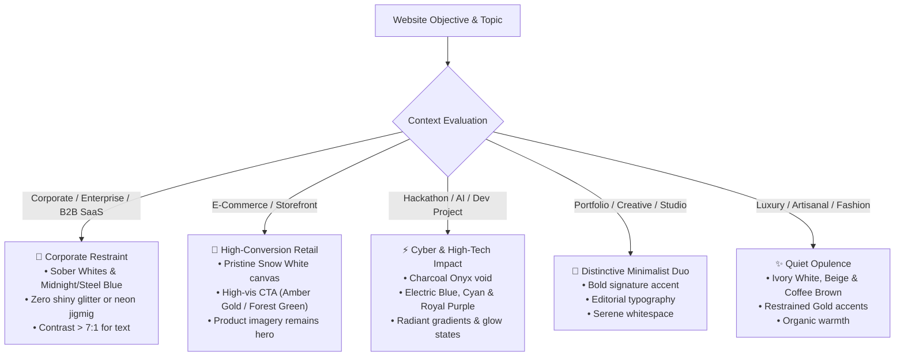

# Chroma-Craft Domain Archetypes & Topic Guidelines

> **The Architectural Rulebook for Website Themes, Visual Dignity, and Anti-Distraction UI.**  
> Automatically detects and enforces appropriate aesthetic restraint, color discipline, and gradient behavior based on website genre.

---

## 1. The Core Design Law: Contextual Appropriateness

Web frontends serve fundamentally different human purposes. A corporate board portal or an enterprise procurement tool requires sober, high-contrast clarity. An e-commerce store requires pristine product fidelity where background decorations never compete with merchandise. Conversely, a hackathon project or developer showcase thrives on electric neon contrast, high saturation, and futuristic dark-mode energy.

---

## 2. The "Anti-Jigmig" Heuristic (Anti-Glitter Directive)

> [!WARNING]
> **What is "Jigmig"?**  
> "Jigmig" refers to amateur, chaotic, over-decorated web UI: gratuitous rainbow gradients, pulsating animated borders, unreadable text over noisy mesh patterns, fluorescent neon buttons on white backgrounds, and glittering elements that destroy visual hierarchy.

### The Universal Anti-Jigmig Rules:
1. **Never distract from primary user intent:** In e-commerce, the product is king. In SaaS, the data and workflow are king. Colors must serve content, not compete with it.
2. **No fluorescent buttons on white surfaces:** Limes (`#00FF00`), Cyans (`#00E5FF`), and Hot Pinks (`#FF69B4`) fail WCAG AA contrast against white and create severe optical glare.
3. **Restrain background gradients:** Never apply saturated multi-hue gradients behind dense blocks of text or tabular data. Background gradients must be soft washes ($< 8\%$ hue shift) or deep dark anchors.
4. **Reserve high saturation for the 10% action tier:** Follow the 60-30-10 rule. 90% of the screen should be quiet, structured, and legible.

---

## 3. Deep-Dive Domain Archetypes

---

### A. E-Commerce & High-Conversion Storefronts 🛒

#### Psychological Tone:
Frictionless, trustworthy, product-prominent, decisive.

#### The E-Commerce Imperatives:
- **Pristine Canvas (`#FBFBFD` Snow White):** Merchandise photographs have their own colors, lighting, and backgrounds. A neutral canvas ensures garments, electronics, and goods render with 100% color accuracy.
- **Distraction-Free Product Cards:** Cards should feature crisp 1px borders (`#C0C0C8` Silver) and subtle hover depth. No rainbow glows.
- **Conversion CTA Anchor:** The "Add to Cart" and "Proceed to Checkout" buttons must be unambiguous and immediately recognizable.
  - *Recommended CTA 1:* **Amber Gold (`#F59E0B`)** or `linear-gradient(135deg, #F59E0B 0%, #AF6E4D 100%)` with `#121214` text.
  - *Recommended CTA 2:* **Forest Green (`#228B22`)** with `#FBFBFD` white text.
  - *Recommended CTA 3:* **Ocean Blue (`#0077BE`)** with `#FBFBFD` white text.
- **Clear Pricing Hierarchy:**
  - Regular Price: `#121214` (Charcoal Onyx) in bold font.
  - Discount / Strikethrough: `#6B7280` (Grey).
  - Discount Badge / "Sale": `#DC143C` (Crimson Red) pill.

#### Forbidden in E-Commerce:
- ❌ Dark mode as the default for physical retail goods (clothing, home decor, groceries) unless selling luxury timepieces or gaming hardware.
- ❌ Heavy background mesh gradients behind product grids.
- ❌ Low-contrast text on product specification sheets.

---

### B. Corporate & Enterprise B2B SaaS 🏢

#### Psychological Tone:
Authoritative, dependable, compliant, disciplined, institutional.

#### The Corporate Imperatives:
- **Clean Structure:** Ground surfaces in `#FBFBFD` Snow White with alternating card containers in `#F8F6F0` Pearl White.
- **Authoritative Blue Anchors:** Use **Steel Blue (`#4682B4`)**, **Ocean Blue (`#0077BE`)**, or **Midnight Blue (`#191970`)** for corporate headers, primary buttons, and navigational active states.
- **Subdued Accents:** Highlight telemetry with **Teal (`#008080`)** or **Forest Green (`#228B22`)**. Keep alert badges in **Apple Red (`#8E1A1A`)** or **Crimson Red (`#DC143C`)**.
- **Corporate Background Gradients:**
  - *Light Hero:* `linear-gradient(180deg, #FBFBFD 0%, #F8F6F0 100%)` (Clean wash).
  - *Executive Tint:* `linear-gradient(180deg, #FBFBFD 0%, #C6E2FF 100%)` (Subtle sky fade).
  - *Dark Security Banner:* `linear-gradient(135deg, #121214 0%, #191970 100%)`.

#### Forbidden in Corporate:
- ❌ Shiny "web3" neon borders, particle effects, or holographic gradients.
- ❌ Pure saturated red for primary buttons (looks like a system alert or error).
- ❌ Unrestrained magenta or hot pink accents in enterprise workflows.

---

### C. Hackathon, AI Demos & High-Tech Launches ⚡

#### Psychological Tone:
Visionary, electric, high-octane, memorable, cutting-edge. Built to blow judges and tech reviewers away in under 60 seconds.

#### The Hackathon Imperatives:
- **Deep Void Canvas:** Ground the frontend in **Charcoal Onyx (`#121214`)** or **Midnight Blue (`#191970`)**.
- **Radiant Electric Accents:** Use **Electric Blue (`#0066FF`)**, **Cyan (`#00E5FF`)**, and **Royal Purple (`#7851A9`)** for interactive elements, glowing pills, and focal highlights.
- **High-Impact Hero Gradients:**
  - *Cyber Nebula:* `linear-gradient(135deg, #121214 0%, #191970 50%, #0066FF 100%)`
  - *Quantum Violet:* `linear-gradient(135deg, #36013F 0%, #7851A9 50%, #00E5FF 100%)`
  - *Cyber Mesh:* Multi-radial glowing points over `#121214`.
- **High-Energy CTA Buttons:**
  - `linear-gradient(135deg, #0066FF 0%, #00E5FF 100%)` with `#121214` bold text.
- **Live Status Badges:** Use **Lime (`#00FF00`)** with a pulsing dot for "API Live" / "GPU Online".

#### Forbidden in Hackathons:
- ❌ Boring generic grey bootstrap themes.
- ❌ Washed-out low-contrast dark themes where cards blend invisibly into the background.
- ❌ Clashing multi-color buttons on the same view (e.g. green + red + orange + purple buttons side-by-side).

---

### D. Personal Portfolio & Creative Developer 🎨

#### Psychological Tone:
Distinctive, artisanal, typography-driven, confident, minimalist.

#### The Portfolio Imperatives:
- **The Signature Duo:** Choose 1 dominant surface (`#FBFBFD` Snow White or `#121214` Charcoal Onyx) and **exactly 1 high-impact signature accent**:
  - *Option 1 (Modern Architectural):* **Terracotta (`#E07A5F`)**
  - *Option 2 (Tech Innovator):* **Electric Blue (`#0066FF`)**
  - *Option 3 (Creative Stylist):* **Violet (`#8F00FF`)**
- **Editorial Card Overlays:** Utilize glassmorphic overlays (`backdrop-filter: blur(12px)`) with subtle 1px border frames (`#C0C0C8` or `rgba(255,255,255,0.08)`).
- **Project Showcase Prominence:** Let screenshots and case studies shine without competing background colors.

---

### E. Fintech & Banking Platforms 💳

#### Psychological Tone:
Bulletproof security, mathematical precision, fiscal stability.
- **Brand Tokens:** Midnight Blue (`#191970`), Steel Blue (`#4682B4`), Pearl White (`#F8F6F0`).
- **Telemetry Indicators:**
  - Inflows / Yield / Positive: Forest Green (`#228B22`).
  - Outflows / Debt / Risk: Apple Red (`#8E1A1A`) or Crimson Red (`#DC143C`).
  - Pending / Clearing: Amber Gold (`#F59E0B`).

---

### F. Luxury, Fashion & Premium Hospitality 🍸

#### Psychological Tone:
Serene, tactile, warm, timeless, opulent.
- **Base Canvas:** Ivory White (`#FFFFF0`) and warm Beige (`#E8DCC4`).
- **Typography & Structural:** Chocolate Brown (`#3D1C02`) and Coffee Brown (`#4A2C2A`).
- **Metallic Accent:** Gold (`#D4AF37`) for monogram seals, star ratings, and subtle keylines.
- **Strict Prohibition:** Absolutely zero electric cyans, neon blues, or cold fluorescent greys.
