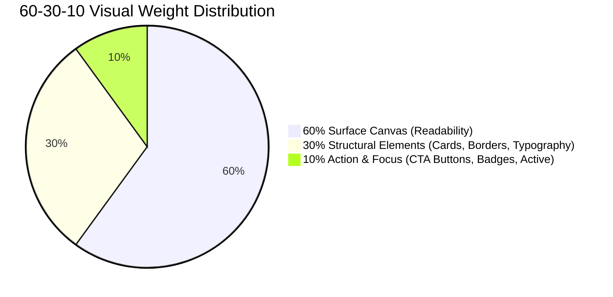

# Chroma-Craft Palette System & Combination Logic

> **Production Recipes for 2-Color, 3-Color (60-30-10), and 4-Color UI Palettes.**  
> Pre-calculated token mappings, Light/Dark mode inversions, and verified WCAG 2.1 AA/AAA contrast ratios.

---

## 1. The 2-Color System (Duo / High-Impact Minimalist)

The 2-Color system is the purest architectural expression of brand identity. It pairs a **Dominant Canvas / Typography Anchor** with a single **High-Impact Accent / CTA**.

### Formula:
`[Dominant Surface / Text Base]` + `[Action / Accent Tone]`

### Curated Duo Recipes:

#### Recipe 2C-01: Cyber Electric Duo
- **Dominant Canvas:** `Charcoal Onyx` (`#121214`)
- **Accent / Action:** `Electric Blue` (`#0066FF`)
- **Light Mode Inversion:** `Snow White` (`#FBFBFD`) + `Electric Blue` (`#0066FF`)
- **Typography Pairing:**
  - Dark Mode: `Snow White` text on `Charcoal Onyx` (18.1:1 AAA)
  - Light Mode: `Charcoal Onyx` text on `Snow White` (18.1:1 AAA)
  - CTA Button: `Electric Blue` with `Snow White` text (4.92:1 AA)
- **Best Suited For:** AI tooling, Developer portfolios, CLI landing pages.

#### Recipe 2C-02: Warm Editorial Terracotta
- **Dominant Canvas:** `Ivory White` (`#FFFFF0`)
- **Accent / Action:** `Terracotta` (`#E07A5F`)
- **Dark Mode Inversion:** `Charcoal Onyx` (`#121214`) + `Terracotta` (`#E07A5F`)
- **Typography Pairing:**
  - Light Mode: `Coffee Brown` (`#4A2C2A`) text on `Ivory White` (16.2:1 AAA)
  - Dark Mode: `Snow White` text on `Charcoal Onyx` (18.1:1 AAA)
  - Accent / Focus: `Terracotta` on `Charcoal Onyx` (7.20:1 AAA)
- **Best Suited For:** Design agencies, Architecture firms, Long-form publications.

#### Recipe 2C-03: Midnight Enterprise Authority
- **Dominant Canvas:** `Snow White` (`#FBFBFD`)
- **Accent / Action:** `Midnight Blue` (`#191970`)
- **Dark Mode Inversion:** `Midnight Blue` (`#191970`) + `Arctic Blue` (`#C6E2FF`)
- **Typography Pairing:**
  - Light Mode: `Midnight Blue` text on `Snow White` (14.2:1 AAA)
  - Dark Mode: `Arctic Blue` text on `Midnight Blue` (10.4:1 AAA)
- **Best Suited For:** Corporate governance, Venture capital, Legal platforms.

#### Recipe 2C-04: High-Conversion Amber Duo
- **Dominant Canvas:** `Snow White` (`#FBFBFD`)
- **Accent / Action:** `Amber Gold` (`#F59E0B`)
- **Dark Mode Inversion:** `Charcoal Onyx` (`#121214`) + `Amber Gold` (`#F59E0B`)
- **Typography Pairing:**
  - Light Mode CTA: `Amber Gold` button with `Charcoal Onyx` text (7.3:1 AAA)
  - Dark Mode CTA: `Amber Gold` button with `Charcoal Onyx` text (7.3:1 AAA)
- **Best Suited For:** Direct-to-Consumer e-commerce banners, High-urgency product drops.

---

## 2. The 3-Color System (The 60-30-10 Web Hierarchy)

The golden rule of spatial color distribution in classical interior design and modern UI design is the 60-30-10 rule:



- **60% — Background & Surface Tone:** Provides generous breathing room, minimizes eye fatigue, ensures clean reading.
- **30% — Structural Tone:** Delineates layout boundaries: navigation headers, card surfaces, borders, icons, secondary copy.
- **10% — Action / Focus Tone:** Commands immediate attention: primary conversion buttons, notification pips, active states.

### Curated 60-30-10 Recipes:

#### Recipe 3C-01: Modern Enterprise SaaS
- **60% Canvas:** `Snow White` (`#FBFBFD`)
- **30% Structure:** `Pearl White` (`#F8F6F0`) card surfaces + `Silver` (`#C0C0C8`) borders + `Grey` (`#6B7280`) secondary text.
- **10% Action:** `Ocean Blue` (`#0077BE`) primary buttons & active indicators.
- **Contrast Check:**
  - Body text (`#121214` on `#FBFBFD`): **18.1:1** (AAA)
  - Button text (`#FBFBFD` on `#0077BE`): **4.52:1** (AA)

#### Recipe 3C-02: Hackathon Cyber Void
- **60% Canvas:** `Charcoal Onyx` (`#121214`)
- **30% Structure:** `Midnight Blue` (`#191970`) header/card surfaces + `Grey` (`#6B7280`) borders.
- **10% Action:** `Cyan` (`#00E5FF`) & `Electric Blue` (`#0066FF`) interactive elements.
- **Contrast Check:**
  - Body text (`#FBFBFD` on `#121214`): **18.1:1** (AAA)
  - Button text (`#121214` on `#00E5FF`): **10.8:1** (AAA)

#### Recipe 3C-03: Clean Retail Conversion
- **60% Canvas:** `Snow White` (`#FBFBFD`)
- **30% Structure:** `Ivory White` (`#FFFFF0`) card containers + `Silver` (`#C0C0C8`) borders + `Charcoal Onyx` typography.
- **10% Action:** `Forest Green` (`#228B22`) "Buy Now" CTA + `Amber Gold` (`#F59E0B`) badges.
- **Contrast Check:**
  - Body text on canvas: **18.1:1** (AAA)
  - White text on Forest Green CTA: **4.56:1** (AA)
  - Dark text on Amber Gold badge: **7.3:1** (AAA)

---

## 3. The 4-Color System (Complete Brand & UI Tokens)

The 4-color system defines the full semantic token set required by modern design systems (Tailwind, CSS Variables, Figma Tokens).

### Standard Token Architecture:
1. `background-base`: The root viewport background canvas.
2. `surface-card`: Foreground card surfaces, modals, popovers, dropdowns.
3. `brand-primary`: Brand identification, primary navigation, active states.
4. `accent-highlight`: Conversion triggers, notification tags, featured badges.
5. `text-primary`: Body and headline typography (calibrated for >10:1 contrast).
6. `border-subtle`: 1px boundary lines and card keylines.

### Domain-Mapped Token Sets:

```text
┌────────────────────────┬─────────────────────┬─────────────────────┐
│ Token Key              │ Light Mode Token    │ Dark Mode Token     │
├────────────────────────┼─────────────────────┼─────────────────────┤
│ background-base        │ Snow White (#FBFBFD)│ Charcoal Onyx(#121214)
│ surface-card           │ Pearl White(#F8F6F0)│ Midnight Blue(#191970)
│ brand-primary          │ Steel Blue (#4682B4)│ Steel Blue  (#4682B4)
│ accent-highlight       │ Ocean Blue (#0077BE)│ Electric Blue(#0066FF)
│ text-primary           │ Charcoal Onyx(#121214) Snow White (#FBFBFD)
│ border-subtle          │ Silver     (#C0C0C8)│ Grey        (#6B7280)
└────────────────────────┴─────────────────────┴─────────────────────┘
```

---

## 4. Light Mode & Dark Mode Inversion Mechanics

Inverting a palette is NOT a naive mathematical invert. A naive RGB invert converts `#FBFBFD` into `#040402` (harsh uncalibrated black) and turns blues into sickly brown-yellows.

### Proper Semantic Inversion Rules:
1. **Never use `#000000` (Pure Pitch Black):** Pure black causes severe OLED smearing and harsh contrast fatigue. Use **`#121214` (Charcoal Onyx)** or **`#191970` (Midnight Blue)** for dark canvas surfaces.
2. **Elevate surfaces with lightness, not opacity:** In light mode, elevated cards use shadows. In dark mode, shadows are invisible; elevated cards must use slightly lighter surfaces (e.g. Canvas `#121214` -> Card `rgba(255, 255, 255, 0.04)` or `#1E1E22`).
3. **Desaturate brand primaries in dark mode:** A bright primary blue that looks solid in light mode can vibrate painfully against dark surfaces. Increase luminance or pair with an electric accent (e.g. Light Mode uses `Ocean Blue #0077BE`, Dark Mode CTA uses `Electric Blue #0066FF`).
4. **Preserve Action Intent:** A primary CTA button should always remain the highest luminance interactive item in dark mode.
